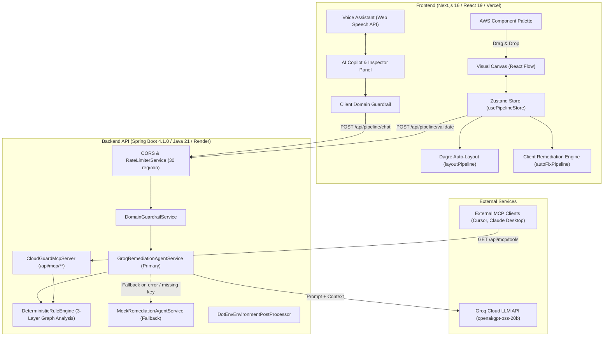

# CloudGuard Pipeline

> Visual AWS architecture designer with deterministic 3-layer security posture scoring, 1-click self-healing remediation, and context-aware AI Copilot.

[](https://github.com/Shrihari6/cloudguard-pipeline/actions/workflows/backend-ci-cd.yml)
[](https://github.com/Shrihari6/cloudguard-pipeline/actions/workflows/frontend-ci-cd.yml)
[](https://adoptium.net/)
[](https://spring.io/projects/spring-boot)
[](https://nextjs.org/)
[](LICENSE)

---

## Live demo

- **Web application**: [cloudguard-pipeline-jade.vercel.app](https://cloudguard-pipeline-jade.vercel.app)
- **Backend API**: [cloudguard-pipeline.onrender.com](https://cloudguard-pipeline.onrender.com)

<!-- screenshot here: Main Canvas with Topology and AI Copilot Inspector -->

---

## What it is

CloudGuard Pipeline solves the gap between visual architecture modeling and cloud security engineering. In modern DevOps and platform teams, data and cloud architectures are frequently sketched on generic diagram tools without real-time compliance validation, leaving IAM misconfigurations, unencrypted data stores, and unmonitored compute resources undetected until code review or runtime incident triage.

Designed for **backend developers**, **data engineers**, and **cloud/network engineers**, the platform allows teams to visually design AWS streaming, compute, storage, and networking graphs while receiving instant security feedback. 

By operating at the intersection of **Cloud Infrastructure**, **Cybersecurity**, and **AI Automation**, CloudGuard Pipeline combines deterministic graph algorithms for mathematical compliance validation with an embedded, context-aware AI Copilot for interactive threat analysis, natural language node placement, and automated architecture remediation.

---

## Key features

### Canvas and pipeline building
- **Interactive DAG canvas**: Drag-and-drop workspace powered by React Flow with custom smoothstep animated connectors, pan/zoom minimap, and grid snapping.
- **21 AWS service nodes**: Covers 7 architectural categories (Ingestion, Compute, Processing, Storage, Networking, Security, Observability) mapped in `NODE_REGISTRY`.
- **Dagre auto-layout**: Sugiyama-style hierarchical layered graph arrangement (`TB` rank direction) with node-pinning preservation (`isManuallyPositioned`).
- **Bidirectional connection awareness**: Recognizes security relationships regardless of edge direction (e.g., `IAM -> Lambda` or `Lambda -> IAM`).

### AI Copilot and natural language canvas actions
- **Live topology context**: Every chat query transmits current canvas nodes, edges, posture metrics, and conversation history (`ChatRequestDTO`) to the LLM agent.
- **Natural language node placement**: Detects intents (e.g., `"add RDS instance"`, `"place Lambda"`) across 21 service aliases and auto-spawns positioned nodes.
- **Voice assistant**: Web Speech API integration with real-time SpeechRecognition (STT), markdown-cleaning speech synthesis (TTS), auto-narration toggle, and silence detection.
- **Zero-token domain guardrails**: Deterministic regex and keyword pre-filtering on both frontend and backend that rejects off-topic queries instantly, protecting API token budgets.

### Security validation and scoring
- **Deterministic 3-layer model**: Pure topological evaluation executed without LLM overhead:
  - **Layer 1 (Identity)**: Mandates direct edge linkage to an `IAM Role` node for least-privilege role assumption.
  - **Layer 2 (Encryption)**: Mandates direct edge linkage to a `KMS Key` node for storage and streaming nodes (S3, Kinesis, RDS, DynamoDB, Redshift, SQS, SNS, EC2).
  - **Layer 3 (Observability)**: Mandates direct edge linkage to a `CloudWatch Logs` node for compute, stream, and database telemetry.
- **Node security strip**: Color-coded visual status dots directly on node cards (Red: IAM, Purple: KMS, Orange: Threat Detection).
- **Per-node manual checklists**: Interactive verification checklists aligned with NIST SP 800-53 and CIS AWS Foundations Benchmark controls.

### Self-healing (auto-fix)
- **Trigger**: Click **⚡ Auto-Fix** in the top bar, **Auto-Fix Node** in the inspector, or submit natural language intents like `"auto-fix architecture"` via text or voice.
- **What it does**:
  1. Identifies missing Layer 1 (IAM), Layer 2 (KMS), and Layer 3 (CloudWatch) relationships across active nodes.
  2. Spawns required security provider nodes (`iam`, `kms`, `cloudwatch`) on the canvas if not already present.
  3. Synthesizes and connects directed, animated edges (`#38bdf8`) from providers to vulnerable targets.
  4. Marks node verification checklists complete.
  5. Executes Dagre hierarchical auto-layout to neatly arrange the newly compliant architecture.
- **What it does NOT do**:
  - Does NOT mutate or deploy live AWS cloud infrastructure (operates strictly within browser canvas state).
  - Does NOT delete existing nodes or functional data-flow links.
  - Does NOT rely on external LLM calls (runs 100% deterministically in zero milliseconds).

### UX and theming
- **Canvas themes**: Dynamic theme switcher with 3 visual modes (`dark`, `light`, `matrix`), background images, and adaptive edge stroke colors.
- **Resizable split panels**: Left component sidebar and right inspector panel feature interactive drag-to-resize handles with bounded widths.
- **Markdown code renderer**: Syntax-highlighted code blocks with 1-click clipboard copy, tables, KaTeX-style math badges, and contextual action chips.

### Platform and DevOps
- **Model Context Protocol (MCP)**: Native REST implementation exposing tool manifests (`GET /api/mcp/tools`) and graph validation (`POST /api/mcp/tools/validateCanvasGraph`) for external agent integration (e.g. Cursor, Claude Desktop).
- **Rate limiting**: Sliding-window rate limiter (30 req/min) backed by `ConcurrentHashMap` and atomic counters.
- **Java 21 Project Loom**: Virtual threads enabled (`spring.threads.virtual.enabled=true`) for non-blocking concurrency.

---

## How it works

### Architecture diagram



### Request flow walkthrough

1. **Drop node**: User drags an AWS service (e.g., Kinesis) onto the canvas. Coordinates are converted via React Flow and stored in Zustand.
2. **Deterministic evaluation**: Canvas automatically triggers `POST /api/pipeline/validate`. The backend `DeterministicRuleEngine` builds a bidirectional adjacency matrix and flags missing IAM, KMS, and CloudWatch links.
3. **AI Copilot interaction**: User asks `"Why did my score drop?"` or clicks a recommended prompt. The request passes the domain guardrail, evaluates live canvas metrics, and queries Groq with the full topology payload.
4. **Remediation**: User clicks **⚡ Auto-Fix**. The client-side remediation engine instantiates missing provider nodes, connects animated edges, verifies checklist rules, and triggers Dagre layout to reach 100% compliance.

---

## Tech stack

| Layer | Technology | Version | Purpose |
|---|---|---|---|
| **Frontend Framework** | Next.js | `16.2.11` | React 19 App Router, SSR/CSR, Dev API rewrites |
| **Frontend Runtime** | React / React DOM | `19.2.4` | Component tree and modern hooks |
| **Canvas & Graph** | React Flow | `11.11.4` | Node-edge interactive DAG workspace |
| **Graph Layout** | Dagre | `0.8.5` | Sugiyama hierarchical auto-layout |
| **State Management** | Zustand | `5.0.14` | Centralized pipeline and chat state |
| **Styling** | Tailwind CSS / PostCSS | `^4` | Utility classes, responsive layout, glassmorphic themes |
| **Icons & Speech** | Lucide React / Web Speech API | `^1.28.0` / Native | Service icons, STT transcription, TTS narration |
| **Backend Framework** | Spring Boot | `4.1.0` | Enterprise REST API and Bean Validation |
| **Backend Language** | Java (Eclipse Temurin) | `21` | LTS runtime with Project Loom Virtual Threads |
| **LLM Provider** | Groq API | REST v1 | High-speed inference using `openai/gpt-oss-20b` |
| **Protocol Integration** | Model Context Protocol | Custom REST | Standardized MCP tool endpoints (`/api/mcp/**`) |
| **Build Tools** | Maven / npm | `3.9+` / `10+` | Multi-module build and dependency management |
| **Hosting & CI/CD** | Vercel / Render / GitHub Actions | Cloud | Decoupled continuous integration and deployment |

---

## Project structure

```text
cloudguard-pipeline/
├── .github/workflows/
│   ├── backend-ci-cd.yml          # Java 21 + Maven CI pipeline
│   └── frontend-ci-cd.yml         # Node 22 + Next.js build pipeline
├── backend/
│   ├── pom.xml                    # Spring Boot 4.1.0 dependencies
│   └── src/
│       ├── main/
│       │   ├── java/com/cloudguard/backend/
│       │   │   ├── BackendApplication.java
│       │   │   ├── DotEnvEnvironmentPostProcessor.java # Auto-loads root .env
│       │   │   ├── WebConfig.java                      # CORS configuration
│       │   │   ├── controller/
│       │   │   │   ├── HealthController.java           # Health probes (/ and /api/health)
│       │   │   │   ├── ValidationController.java       # /api/pipeline/validate and /chat
│       │   │   │   └── GlobalExceptionHandler.java     # Structured JSON error handler
│       │   │   ├── dto/                                # Immutable Java records
│       │   │   ├── engine/
│       │   │   │   └── DeterministicRuleEngine.java   # 3-layer topological rule engine
│       │   │   ├── mcp/
│       │   │   │   ├── CloudGuardMcpServer.java        # MCP REST tool endpoints
│       │   │   │   ├── CloudGuardMcpTools.java
│       │   │   │   └── McpTool.java
│       │   │   └── service/
│       │   │       ├── DomainGuardrailService.java     # Zero-token off-topic filter
│       │   │       ├── GroqRemediationAgentService.java# Primary LLM integration
│       │   │       ├── MockRemediationAgentService.java# Fallback deterministic provider
│       │   │       ├── RateLimiterService.java         # 30 req/min sliding window
│       │   │       └── RemediationAgentService.java    # Service interface
│       │   └── resources/
│       │       ├── application.properties              # Loom, port, and Groq configs
│       │       └── META-INF/spring.factories           # PostProcessor registration
│       └── test/                                       # Unit and slice test suites
├── frontend/
│   ├── package.json               # Next.js 16, React 19, Zustand 5, React Flow 11
│   ├── next.config.ts             # Dev proxy rewrite (/api/* -> :8081)
│   ├── tsconfig.json
│   ├── app/
│   │   ├── layout.tsx             # Root layout and theme wrapper
│   │   ├── page.tsx               # Primary application view
│   │   └── globals.css            # Tailwind 4 configuration
│   └── src/
│       ├── components/
│       │   ├── agent/             # InspectorPanel, AgentPanel, MarkdownRenderer
│       │   ├── canvas/            # PipelineCanvas, PipelineNode, SecurityStrip, ThemeSwitcher
│       │   ├── sidebar/           # ComponentSidebar, PaletteItem
│       │   └── ui/TopBar.tsx      # Top bar metrics, auto-fix, and validate controls
│       ├── hooks/
│       │   ├── usePipelineStore.ts# Core Zustand store implementation
│       │   ├── useVoiceAssistant.ts# Speech-to-text and text-to-speech hook
│       │   └── useDragDrop.ts     # HTML5 drag-and-drop coordinate translation
│       ├── lib/
│       │   ├── nodeRegistry.ts    # 21 AWS service metadata definitions
│       │   ├── securityRules.ts   # NIST/CIS verification rules per service
│       │   ├── autoFixPipeline.ts # Self-healing topology synthesis algorithm
│       │   ├── layoutPipeline.ts  # Dagre graph layout calculator
│       │   ├── domainGuardrails.ts# Client-side domain validator
│       │   └── agentCanvasActions.ts # Natural language intent parser
│       └── types/index.ts         # TypeScript interface definitions
├── Dockerfile                     # Multi-stage production container build
├── .env.example                   # Environment variable template
└── LICENSE                        # MIT License
```

---

## Getting started

### Prerequisites

- **Java**: OpenJDK 21 or Eclipse Temurin 21 (`java -version`)
- **Node.js**: Node.js 20+ or 22 LTS (`node -version`)
- **Build tools**: Apache Maven 3.9+ (`mvn -version`) and npm 10+
- **Groq API Key** *(Optional)*: Required for live LLM chat. If omitted, backend falls back to `MockRemediationAgentService`.

### 1. Clone repository

```bash
git clone https://github.com/Shrihari6/cloudguard-pipeline.git
cd cloudguard-pipeline
```

### 2. Configure environment variables

Create a root `.env` file (loaded automatically by both frontend and backend):

```bash
# Windows PowerShell
Copy-Item .env.example .env

# macOS / Linux
cp .env.example .env
```

| Variable Name | Component | Description | Required? |
|---|---|---|---|
| `GROQ_API_KEY` | Backend | Groq Cloud API key for live AI Copilot chat | No *(falls back to mock)* |
| `GROQ_MODEL` | Backend | LLM model identifier (default: `openai/gpt-oss-20b`) | No |
| `PORT` | Backend | HTTP server port (default: `8081` locally; set by Render) | No |
| `NEXT_PUBLIC_API_BASE_URL` | Frontend | Target backend API base URL | No *(defaults to Render in prod, rewrite in dev)* |

### 3. Run backend (Spring Boot)

```bash
cd backend

# Windows PowerShell
.\mvnw.cmd spring-boot:run

# macOS / Linux
./mvnw spring-boot:run
```
*Backend initializes on `http://localhost:8081` with Project Loom virtual threads enabled.*

### 4. Run frontend (Next.js)

Open a separate terminal:

```bash
cd frontend
npm install
npm run dev
```
*Frontend opens on `http://localhost:3000`. In development mode, `next.config.ts` automatically proxies `/api/*` to `http://localhost:8081`.*

### 5. Verify installation

1. Health probe: `curl http://localhost:8081/api/health` -> returns `"CloudGuard Backend is running!"`.
2. Open `http://localhost:3000` in your browser.
3. Drag **Kinesis** to the canvas -> posture score drops to `0%` (or `0/3`).
4. Click **⚡ Auto-Fix** in the top bar -> IAM, KMS, and CloudWatch nodes appear, animated edges connect, and score reaches `100%`.

---

## API reference

| Method | Endpoint | Request Body | Response Body | Description |
|---|---|---|---|---|
| `GET` | `/` | *None* | `text/plain` | Root health check |
| `GET` | `/api/health` | *None* | `text/plain` | API operational status |
| `POST` | `/api/pipeline/validate` | `CanvasGraphDTO` | `CanvasMetricsResponseDTO` | Deterministic 3-layer security evaluation |
| `POST` | `/api/pipeline/chat` | `ChatRequestDTO` | `ChatResponseDTO` | Canvas-aware AI Copilot query |
| `GET` | `/api/mcp/tools` | *None* | `Map<String, Object>` | Model Context Protocol tool manifest |
| `POST` | `/api/mcp/tools/validateCanvasGraph` | `CanvasGraphDTO` | `CanvasMetricsResponseDTO` | MCP tool execution endpoint |

### Example: POST `/api/pipeline/validate`

**Request:**
```json
{
  "nodes": [
    { "id": "kinesis-1", "type": "kinesis", "label": "Kinesis Stream" },
    { "id": "iam-1", "type": "iam", "label": "IAM Role" }
  ],
  "edges": [
    { "id": "e-1", "source": "iam-1", "target": "kinesis-1" }
  ]
}
```

**Response (200 OK):**
```json
{
  "totalPassedChecks": 1,
  "totalPossibleChecks": 3,
  "overallScorePercentage": 33.3,
  "nodeMetricsList": [
    {
      "nodeId": "kinesis-1",
      "nodeType": "kinesis",
      "score": 33,
      "layer1Identity": {
        "ruleId": "iam-layer",
        "title": "IAM Identity Control",
        "isPassed": true,
        "description": "Node is connected to an IAM Role — identity layer satisfied."
      },
      "layer2Encryption": {
        "ruleId": "kms-layer",
        "title": "Encryption at Rest (KMS)",
        "isPassed": false,
        "description": "No KMS Key connected. Data at rest is unencrypted."
      },
      "layer3Logging": {
        "ruleId": "cw-layer",
        "title": "Observability (CloudWatch)",
        "isPassed": false,
        "description": "No CloudWatch Logs connected. Execution and error logging is missing."
      }
    }
  ],
  "suggestedRemediations": [
    "CONNECT_NODES: Attach a KMS Key node to [KINESIS / kinesis-1] to enable encryption at rest.",
    "CONNECT_NODES: Attach a CloudWatch Logs node to [KINESIS / kinesis-1] to enable observability and threat detection."
  ]
}
```

---

## Security considerations

- **API key protection**: `GROQ_API_KEY` is loaded strictly on the backend. The key is never exposed to browser bundles or logged in plaintext. If omitted, the backend falls back gracefully to `MockRemediationAgentService`.
- **CORS configuration**: `WebConfig.java` allows pre-flighted credentials and restricts origins using pattern matching against production frontends (`https://*.vercel.app`, `https://cloudguard-pipeline-jade.vercel.app`) and local development ports.
- **In-memory rate limiting**: `RateLimiterService` enforces an IP/client threshold of 30 requests per minute with automated memory pruning for stale windows.
- **Input validation**: DTOs enforce `@NotNull`, `@NotBlank`, and `@Valid` constraints. `GlobalExceptionHandler` intercepts validation failures and returns RFC-compliant 400 error payloads.
- **Out of scope**: Direct AWS account credentials (access keys/secret keys), automated IAM role provisioning in live AWS accounts, and runtime VPC packet inspection are deliberately out of scope for this architecture modeling tool.

---

## Engineering highlights

### Graph algorithms and layout
- **Adjacency graph construction**: `DeterministicRuleEngine` builds a bidirectional adjacency map ($O(V + E)$) from directed React Flow edges, enabling bidirectional security relationship resolution.
- **Sugiyama layered DAG layout**: `layoutPipeline.ts` uses Dagre with top-to-bottom hierarchy (`rankdir: 'TB'`, `nodesep: 60`, `ranksep: 80`) while respecting manual pin flags (`isManuallyPositioned`).
- **Remediation graph synthesis**: `autoFixPipeline.ts` dynamically calculates topological deficiencies, instantiates missing security providers, and establishes animated linkages in a single pass.

### Design patterns
- **Strategy & fallback pattern**: `RemediationAgentService` defines a common contract implemented by `@Primary GroqRemediationAgentService` with automated fallback to `MockRemediationAgentService`.
- **Double-layer domain guardrail**: Dual-filter architecture where `domainGuardrails.ts` (client) and `DomainGuardrailService.java` (server) intercept off-topic prompts before reaching the LLM.
- **Environment post-processor**: `DotEnvEnvironmentPostProcessor` implements Spring Boot's `EnvironmentPostProcessor` to load `.env` variables at the lowest property priority, allowing cloud environment variables to override seamlessly.

### Concurrency and state management
- **Virtual threads (Project Loom)**: Configured in `application.properties` to ensure blocking REST requests to the Groq API do not saturate backend OS threads.
- **Thread-safe rate limiting**: Sliding window counters utilize `ConcurrentHashMap` and `AtomicInteger` for lock-free concurrency.
- **Zustand store architecture**: Single-source-of-truth state machine handling canvas graphs, active panel routing (`CHAT`, `NODE_CHECKLIST`, `GLOBAL_REPORT`), and optimistic metrics synchronization.

---

## Deployment

### Frontend (Vercel)
1. Import repository into Vercel and set the root directory to `frontend`.
2. Configure Environment Variable:
   - `NEXT_PUBLIC_API_BASE_URL`: `https://cloudguard-pipeline.onrender.com`
3. Deploy. Build command: `npm run build`.

### Backend (Render / Docker)
Deploy using Docker or native Java runtime:
- **Build Command (Maven)**: `mvn clean package -DskipTests`
- **Start Command**: `java -jar target/backend-0.0.1-SNAPSHOT.jar`
- **Environment Variables**:
  - `PORT`: Automatically provided by Render.
  - `GROQ_API_KEY`: Groq API secret token.
  - `GROQ_MODEL`: `openai/gpt-oss-20b`

---

## Known limitations

- **Static topological validation**: Validates graph connectivity rules; does not perform live AWS API calls or pull actual runtime telemetry from AWS CloudTrail or AWS Config.
- **In-memory state and rate limiting**: Rate limits and chat history are memory-resident and not synchronized across multi-instance clusters via Redis.
- **Canvas-only remediation**: Auto-fix updates canvas node relationships and compliance checklists; it does not directly write Terraform HCL or AWS CDK code to disk.

---

## Roadmap

- [ ] **Infrastructure as Code (IaC) export**: 1-click Terraform (`.tf`) and AWS CloudFormation template generator for the active canvas graph.
- [ ] **Expanded AWS catalog**: Support for Amazon SQS FIFO, DynamoDB Streams, AWS Step Functions, and Amazon Aurora Serverless.
- [ ] **Custom compliance rule editor**: Allow teams to define custom YAML/JSON organizational security rules (e.g. mandatory AWS WAF on all API Gateways).
- [ ] **Redis-backed persistent sessions**: Distributed rate limiting and persistent multi-tenant chat history.
- [ ] **Spring AI native MCP upgrade**: Transition from custom REST MCP controller to official `spring-ai-starter-mcp-server` upon library stabilization.

---

## Contributing and license

Contributions are welcome. Please open an issue or pull request following standard GitHub workflow.

This project is licensed under the **MIT License** — see the [LICENSE](LICENSE) file for details.

### Author

- **GitHub**: [@Shrihari6](https://github.com/Shrihari6)
- **Repository**: [Shrihari6/cloudguard-pipeline](https://github.com/Shrihari6/cloudguard-pipeline)
